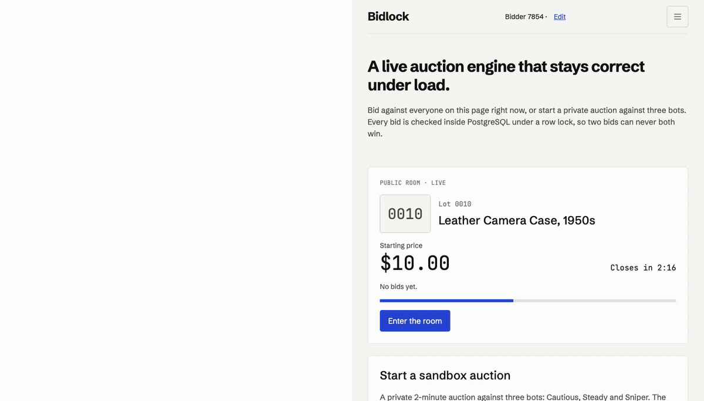
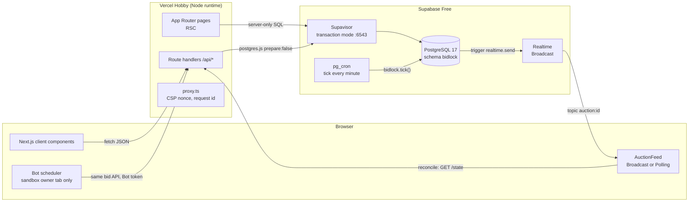
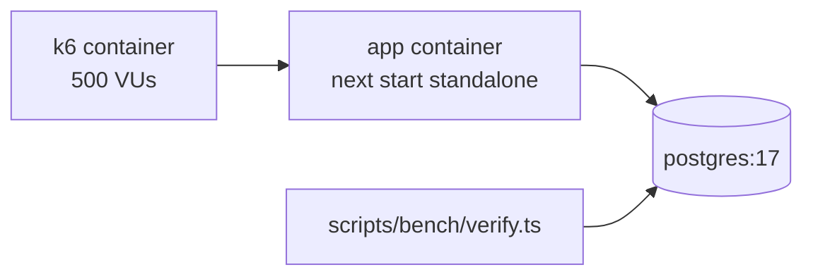

# Bidlock

A live auction engine that keeps bidding, closing and settlement correct under concurrent load.

[Try the live demo](https://bidlock.firatkil.com).



Recorded locally with two independent browser contexts and the existing test clock; production never receives scripted bids. Payment is simulated.

## The claim

Thousands of concurrent bid requests, exactly one winner, zero invalid bids. The published CI run used 500 virtual users over 60 seconds (10-second ramp); the table below is generated from [latest.json](bench/results/latest.json), with grouped counts and latency rounded to two decimals. Raw measurements remain unchanged in the JSON.

| Date       | VUs | Bid requests | Accepted | p95       | p99       | Unexpected errors | Invariant violations |
| ---------- | --- | ------------ | -------- | --------- | --------- | ----------------- | -------------------- |
| 2026-11-07 | 500 | 28,925       | 245      | 269.23 ms | 329.69 ms | 0 (0%)            | 0                    |

**`thresholds.passed=false`.** p95 was 269.23 ms against the 250 ms target; p99 was 329.69 ms against 600 ms. Unexpected errors and invariant violations were zero. [D-92](docs/PRD.md) accepts the p95 gap for this published result. Profiling identified requests waiting for the single-auction row lock and pool connections; the lock preserves correctness. Thresholds remain unchanged. These are CI measurements, not a production capacity claim.

[Load workflow](.github/workflows/load.yml) · [Run and methodology](bench/SUMMARY.md)

## How it stays correct

- [Serialize bids with an auction row lock](https://github.com/firatkill/bidlock/blob/main/db/migrations/0005_place_bid.sql#L68): each bid reads the latest committed auction state after acquiring it.
- [Read server time after the lock](https://github.com/firatkill/bidlock/blob/main/db/migrations/0005_place_bid.sql#L75): waiting in a queue cannot make a late bid valid.
- [Replay the stored idempotent result](https://github.com/firatkill/bidlock/blob/main/db/migrations/0005_place_bid.sql#L77): the same key and payload return the original outcome; changed payloads are rejected.
- [Enforce bid rules in SQL](https://github.com/firatkill/bidlock/blob/main/db/migrations/0005_place_bid.sql#L93): closing time, leader, minimum increment and maximum amount are checked together.
- [Extend late bidding within a cap](https://github.com/firatkill/bidlock/blob/main/db/migrations/0005_place_bid.sql#L124): accepted late bids can move the close forward, with the result and auction update committed atomically.

## Run it yourself

Use Node 24 (minimum 22), pnpm 10.34.7 and Docker. Run these commands from the repository root:

```sh
pnpm install --frozen-lockfile
pnpm db:up
cp .env.example .env.local
pnpm db:reset --db bidlock
pnpm dev
```

The reset command deletes data in the selected local database. The app runs at `http://localhost:3000`; PostgreSQL uses port 54329. Database scripts read process environment variables, never `.env.local`; their admin URL defaults to local `bidlock_test`. Set `DATABASE_URL_ADMIN` explicitly when migrating another local database. See [the environment template](.env.example) and [database setup](docs/TRD.md#6-database).

```sh
pnpm test:all
pnpm load:local
```

`test:all` runs lint, typecheck, unit tests, a local test-database reset, pgTAP, concurrency integration, production build, Chromium installation and Playwright E2E in sequence. It resets `bidlock_test`; E2E uses port 3100. Export the local test-mode build environment shown in the [CI E2E job](.github/workflows/ci.yml), using local port 54329 for both database URLs, before running it. `pnpm check:guards` is a separate static check.

`load:local` starts the isolated Compose load stack and resets its local load database. It targets `http://app:3000` only. Never run load tests or scripted bids against the live demo. Published benchmark results come from the [CI load workflow](.github/workflows/load.yml).

## Architecture



Local, CI and load-test topology replaces Supabase with `postgres:17` (plus pgTAP), has no pg_cron (lazy transitions and an optional `pnpm db:ticker` loop cover it) and uses `PollingFeed`.



## Stack

Resolved 2026-10-21 from the package registry, using the specified major lines where the TRD constrains them.

| Package                     | Version |
| --------------------------- | ------- |
| next                        | 16.4.2  |
| react                       | 19.3.1  |
| react-dom                   | 19.3.1  |
| zod                         | 4.6.7   |
| postgres                    | 3.4.9   |
| @supabase/supabase-js       | 2.118.0 |
| server-only                 | 0.0.1   |
| sonner                      | 2.0.8   |
| @radix-ui/react-slot        | 1.5.0   |
| @radix-ui/react-dialog      | 1.3.1   |
| class-variance-authority    | 0.7.1   |
| clsx                        | 2.1.1   |
| cn                          | 0.5.0   |
| tailwind-merge              | 3.7.0   |
| lucide-react                | 1.61.0  |
| typescript                  | 5.9.3   |
| @types/node                 | 26.6.5  |
| @types/react                | 19.3.0  |
| @types/react-dom            | 19.3.0  |
| tailwindcss                 | 4.3.3   |
| @tailwindcss/postcss        | 4.3.3   |
| eslint@9                    | 9.39.5  |
| eslint-config-next          | 16.4.2  |
| typescript-eslint@8         | 8.72.0  |
| prettier                    | 3.9.10  |
| vitest                      | 4.1.12  |
| @vitest/coverage-v8         | 4.1.12  |
| @testing-library/react      | 16.3.3  |
| @testing-library/user-event | 14.6.8  |
| jsdom                       | 30.1.3  |
| tsx                         | 4.23.15 |
| shadcn                      | 3.8.5   |
| @playwright/test            | 1.64.1  |
| playwright-core             | 1.64.1  |
| @axe-core/playwright        | 4.14.0  |
| @mermaid-js/mermaid-cli     | 11.17.0 |
| pnpm@10                     | 10.34.7 |

Node: 24 (minimum 22). Next 16 uses `src/proxy.ts` rather than `middleware.ts` (A-10); CSP and standalone serving are verified in T-25/T-33. See [Next upgrade guide](https://nextjs.org/docs/app/guides/upgrading/version-16).

## Deployment notes

Recorded 2026-11-08. Production observations below were supplied by the owner/reviewer, not rerun by the recording agent. No production scripts or load tests were run.

- Supabase project `ufnpdyrpsxjaiyrsdqlz`: Free, Frankfurt `eu-central-1`, PostgreSQL 17.11 (64-bit; `server_version_num=170011`), pg_cron enabled. Only `public` and `graphql_public` are exposed; public Realtime channels allowed. Settings: `prod | broadcast | 0`.
- Migrations 0001–0014 applied. The owner's IPv6-only direct host was unreachable; migrations used the documented session-pooler fallback. `db:env supabase` and `db:cron` (twice) succeeded.
- **A-02 passed:** transaction pooler port 6543 with `bidlock_app.<ref>` returned `current_user=bidlock_app`.
- **A-03 passed:** exactly four active jobs (`bidlock-cleanup`, `bidlock-cron-log-gc`, `bidlock-rate-gc`, `bidlock-tick`); run details show `succeeded`.
- **A-01 passed:** supabase-js 2.118.0 and the publishable key subscribed to public `auction:test`. Direct `realtime.send(…, false)` delivered `{"x":1}` at 12:35:49Z; a postgres-owned security-definer pg_temp probe delivered `{"x":2}` at 12:36:17Z. No fallback needed.
- Vercel Hobby, Node 24.x: `bidlock-tawny.vercel.app`, custom domain `bidlock.firatkil.com`, valid HTTPS. DNS CNAME `bidlock` → `96628b3a8b6951b4.vercel-dns-017.com.`. After correcting the function region and redeploying, `x-vercel-id` was `fra1::fra1::…` (previously `fra1::iad1`).
- Health returned `{"status":"ok","db":"ok","demo_mode":"on","version":"84c53edcabe553f8e027cf6bd2a0a222c05bd169"}`, matching origin/main at deployment. [Keepalive dispatch](https://github.com/firatkill/bidlock/actions/runs/42482100743) passed.
- Manual two-network Broadcast, public lot 0006: phone on mobile data bid $12.00 at server time 12:58:27.783Z; desktop on home broadband rendered it at 12:58:27.944Z (**161 ms**). Owner confirmed the desktop's $11.00 bid appeared on the phone (reverse latency not measured). Desktop made no requests during 10 idle seconds. No scripted bids.
- **D-96:** no Preview environment. Ignored Build Step is `[ "$VERCEL_GIT_COMMIT_REF" != "main" ]`; only main builds. `DATABASE_URL`, `SESSION_SECRET`, `BOT_TOKEN_SECRET`, `IP_HASH_SALT` are Production-only.

Public documentation checked **2026-11-08**, without login:

| Assumption | Published allowance / contract                                                                                                                                                                                                                                                                                       | Source                                                                                                     |
| ---------- | -------------------------------------------------------------------------------------------------------------------------------------------------------------------------------------------------------------------------------------------------------------------------------------------------------------------- | ---------------------------------------------------------------------------------------------------------- |
| A-04       | Hobby $0/month; monthly included 1,000,000 function invocations, 4 active CPU-hours, 360 GB-hours provisioned memory, 100 GB Fast Data Transfer, 10 GB Fast Origin Transfer and 1,000,000 CDN requests.                                                                                                              | [Pricing](https://vercel.com/pricing), [Hobby](https://vercel.com/docs/plans/hobby)                        |
| A-04       | Fluid Compute Hobby function duration default/max 300 s; 2 GB memory / 1 vCPU. 100 deployments/day. These are published limits, not measured usage or a capacity guarantee.                                                                                                                                          | [Function limits](https://vercel.com/docs/functions/limitations), [limits](https://vercel.com/docs/limits) |
| A-06       | Free $0/month: 500 MB database, 5 GB egress plus 5 GB cached egress, 1 GB storage, 200 peak Realtime connections, 2 million messages/month, 256 KB message size.                                                                                                                                                     | [Supabase pricing](https://supabase.com/pricing)                                                           |
| A-06       | Free Realtime: 100 messages/s, 100 channel joins/s, 100 channels/connection, 256 KB Broadcast payload. Actual project usage has not been recorded; owner must capture dated database size, peak connections, messages and egress from Usage.                                                                         | [Realtime limits](https://supabase.com/docs/guides/realtime/limits)                                        |
| A-12       | Vercel documents x-forwarded-for as the client's public IP; it overwrites incoming X-Forwarded-For and does not forward external IP values to prevent spoofing. Custom trusted-proxy forwarding is an Enterprise feature. Documentation supports the trust contract; distinct runtime salted keys remain unverified. | [Request headers](https://vercel.com/docs/headers/request-headers#x-forwarded-for)                         |

**Open follow-ups:** A-05 stays open until after **2026-11-15**: verify more than seven days of activity with only keepalive traffic (restart the observation window if manual traffic intervenes). Supabase publishes pausing after one inactive week; a successful initial query or cron is not proof that keepalive prevents pausing. A-04 actual dashboard usage and A-06 actual usage remain unrecorded; no capacity claim is made.

For **A-12**, next time the owner and reviewer each place one ordinary manual bid from mobile data/home broadband, inspect `bidlock.rate_counters` entries for `bid_ip_60s` immediately, within the 60-second window. Correlate each counter update with bid timing and confirm two distinct salted keys; record only time, count and distinctness, never raw IPs, secrets or full hashes. The previous counters expired before inspection. No scripted production bidding or spoofing test is authorized.

**Paused database (TRD §18.7, option b):** The demo database may be paused; it restores on request. The owner restores the project from the Supabase dashboard, checks the tick and cron jobs, verifies health, and reviews keepalive history. This is the documented free-tier default, not an automatic restoration guarantee. See the [paused-database runbook](docs/TRD.md#187-runbook-paused-database).

Production mobile Lighthouse after PR #61 deployed (`da57813`), recorded by the reviewer on **2026-11-08**: Performance **100**, Accessibility **100**, Best Practices **100**. [Report](qa/lighthouse/t47-production-after.report.html).

## Docs

- [Product requirements and decisions](docs/PRD.md)
- [Technical design and runbooks](docs/TRD.md)
- [Owner decisions](docs/OWNER-DECISIONS.md)
- [Implementation plan and release checklist](docs/IMPLEMENTATION_PLAN.md#release-checklist-v100)
- [Progress and open questions](docs/PROGRESS.md)
- [Benchmark methodology](bench/SUMMARY.md)
- [Changelog](CHANGELOG.md)

## License

[MIT](LICENSE) — Fırat Kıl.
