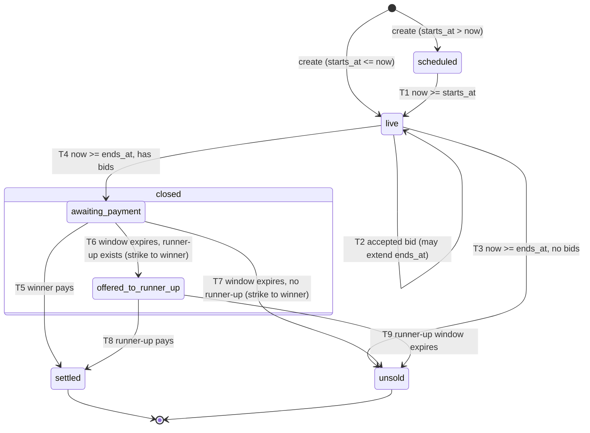

# Bidlock: Product Requirements Document

| Field | Value |
|---|---|
| Product | Bidlock, a live auction engine that stays correct under load |
| Owner | Fırat Kıl |
| Status | Approved for implementation |
| Version | 1.0 (2026-10-20) |
| Live demo | https://bidlock.firatkil.com |
| Repository | https://github.com/firatkill/bidlock (MIT) |
| Companion docs | [TRD.md](./TRD.md) (how), [IMPLEMENTATION_PLAN.md](./IMPLEMENTATION_PLAN.md) (order of work), [../AGENTS.md](../AGENTS.md) (rules for coding agents) |

Requirement keywords: **Must** = required for v1.0 release. **Should** = required unless a documented blocker exists; record the blocker in the decisions log. **Could** = do only after every Must and Should is done.

ID scheme used across all docs:

| Prefix | Meaning | Defined in |
|---|---|---|
| US-xx | User story | PRD §5 |
| FR-xx | Functional requirement | PRD §6 |
| NFR-xx | Non-functional requirement | PRD §8 |
| INV-xx | Correctness invariant | PRD §8.1, enforcement in TRD §9 |
| DB-xx | pgTAP test file / case group | TRD §15.2 |
| INT-xx | TypeScript integration test | TRD §15.3 |
| UT-xx | Vitest unit test | TRD §15.4 |
| E2E-xx | Playwright test | TRD §15.5 |
| LOAD-xx | k6 load test and verification | TRD §15.6 |
| T-xx | Implementation task | IMPLEMENTATION_PLAN.md |
| D-xx | Decision | PRD §14 |
| A-xx | Assumption to verify at build time | TRD §21 |

---

## 1. Problem

Fırat built the backend of a live liquidation-auction marketplace at work. Its bidding rules run inside PostgreSQL functions so they stay correct under concurrency: idempotent bids, anti-sniping soft close, automatic closing and second-chance offers. That code is private, so recruiters and reviewers cannot see it.

Most public auction demos are a React counter and a `POST /bid` that reads the price, compares in JavaScript and writes. They break the first time two bids arrive in the same millisecond. A reviewer cannot tell from a resume line whether a candidate knows the difference.

Bidlock is a small, open-source auction engine that makes the difference visible and checkable:

- A visitor can bid live against other visitors or against three bots in under 30 seconds.
- A reviewer can read one SQL function (`place_bid`) and one page (`/how-it-works`) and understand why the engine cannot produce two winners.
- A load test with 500 concurrent bidders runs weekly in free CI and publishes its numbers, including zero invariant violations. The live site never takes that load.

## 2. Goals

| ID | Goal | Measured by |
|---|---|---|
| G-1 | Prove correctness under concurrency in public | INT-01 and LOAD-01 pass in CI on every run; results committed in `bench/results/` |
| G-2 | Give a recruiter a working, understandable demo in 30 seconds | Lobby shows a live auction, a one-click bid path and the benchmark headline above the fold at 1280x800 and 360x740 |
| G-3 | Give a backend reviewer a 10-minute deep read | `/how-it-works` plus `db/migrations/*place_bid*` explain the lock, idempotency, soft close, closing and settlement with no gaps |
| G-4 | Keep hosting cost near zero | Monthly bill $0 excluding the domain (NFR-30) |
| G-5 | Be reproducible by anyone | `pnpm install && pnpm db:up && pnpm test:all` passes on a clean machine with Docker and Node 22+ (`test:all` installs the Playwright Chromium build itself; on Linux the first run may need `pnpm exec playwright install-deps chromium`) |

## 3. Non-goals

- Real payments, Stripe, invoices, taxes, shipping.
- Real user accounts, email, passwords, OAuth.
- Seller tooling: creating custom lots, uploading images, reserve prices, buy-now prices.
- Proxy (maximum) bidding. Every bid is an explicit amount.
- Multi-currency. All money is USD in integer cents.
- Admin dashboard. Operations use environment variables and SQL (runbook in TRD §18.6).
- Horizontal scale beyond one Postgres primary. The engine is correct on one primary; sharding is out of scope.
- Mobile apps.
- Internationalisation. UI copy is English only.

## 4. Audience

| Persona | Time budget | What they do | What must be true |
|---|---|---|---|
| P1 Recruiter | 30 s | Opens the link from a CV, sees motion, maybe clicks one bid | The page is live, bidding works with one click, the headline number is visible, nothing asks them to sign up |
| P2 Backend engineer reviewer | 10 min | Reads `/how-it-works`, opens the repo, reads `place_bid`, the tests and the CI run | Rules are in SQL with comments, the state machine is drawn, tests cover every rule, CI is green, the benchmark is reproducible |
| P3 Casual visitor | 2–5 min | Competes in the public room, starts a sandbox | Real-time updates, clear outbid and win states, fair countdown |
| P4 Owner (Fırat) | rare | Keeps the demo alive and cheap; stops abuse | One env var or one SQL statement disables bidding; database pausing has a documented fix |

## 5. User stories

| ID | As a | I want to | So that | FRs |
|---|---|---|---|---|
| US-01 | recruiter | open the site and see a live auction with a price and countdown immediately | I know the project works without reading anything | FR-40, FR-41, FR-60 |
| US-02 | recruiter | place a bid with one click without signing up | I can try it in seconds | FR-20, FR-21, FR-63 |
| US-03 | visitor | compete with other people in one shared public room | the auction feels real | FR-30, FR-31, FR-45 |
| US-04 | visitor | see the price, leader and bid list update without refreshing | I can react to other bidders | FR-45, FR-46, FR-47 |
| US-05 | visitor | know immediately when I am outbid and re-bid from the keyboard | I can compete fast | FR-63, FR-64, FR-71 |
| US-06 | visitor | see that a late bid extends the auction | I understand sniping does not work | FR-07, FR-65 |
| US-07 | winner | pay inside a time window with a simulated button | I see the full lifecycle | FR-11, FR-12, FR-66 |
| US-08 | runner-up | receive a second-chance offer when the winner does not pay | I see the runner-up flow | FR-13, FR-66 |
| US-09 | visitor | start a private auction against three bots | I can try the engine when nobody else is online | FR-32, FR-33, FR-34, FR-35 |
| US-10 | visitor | change my display name | I recognise myself in the bid list | FR-22, FR-68 |
| US-11 | backend reviewer | read the rules, state machine, concurrency design and benchmark on one page | I can judge the engineering in 10 minutes | FR-69, FR-70 |
| US-12 | backend reviewer | clone the repo and run every test locally with only Docker and Node | I can verify the claims myself | FR-90, FR-91, FR-92 |
| US-13 | backend reviewer | run the load test locally and in CI and see invariant checks | I trust the headline number | FR-93, FR-94, FR-95 |
| US-14 | keyboard or screen-reader user | follow price changes and bid without a mouse | I can use the demo | FR-71, NFR-20..NFR-24 |
| US-15 | owner | put the demo in read-only mode or switch it off | I can stop abuse quickly | FR-36, FR-37 |
| US-16 | owner | keep hosting at $0 with load tests never touching production | the demo can stay online for years | NFR-30..NFR-33 |

---

## 6. Functional requirements

### 6.1 Auction engine (all rules live in SQL; TRD §5–§8)

| ID | Pri | Requirement |
|---|---|---|
| FR-01 | Must | An auction has exactly one status from `scheduled`, `live`, `closed`, `settled`, `unsold`. When `closed`, it also has a payment state from `awaiting_payment`, `offered_to_runner_up`. `settled` has payment state `paid`. `unsold` has payment state `expired` (after a failed settlement) or none (no bids). Transitions follow the state machine in §7 only. |
| FR-02 | Must | A bid is accepted only when all hold: the auction is `live`; server time `now < ends_at`; the bidder is not the current leader; the amount is an integer number of cents; amount ≥ `starting_price` when there are no bids, otherwise amount ≥ `current_price + increment(current_price)`; amount ≤ minimum next bid + 100 × increment (anti-typo cap); amount ≤ 100,000,000 cents ($1,000,000). |
| FR-03 | Must | The increment depends on the current price via this ladder (lower bound inclusive): |

| Current price (USD) | Increment |
|---|---|
| $0.00 – $9.99 | $0.50 |
| $10.00 – $49.99 | $1.00 |
| $50.00 – $99.99 | $2.00 |
| $100.00 – $249.99 | $5.00 |
| $250.00 – $499.99 | $10.00 |
| $500.00 – $999.99 | $25.00 |
| $1,000.00 – $2,499.99 | $50.00 |
| $2,500.00 – $4,999.99 | $100.00 |
| $5,000.00 and above | $250.00 |

Examples: price $9.99 → next minimum $10.49. Price $10.00 → $11.00. Price $49.50 → $50.50. Price $99.00 → $101.00. No bids, starting price $10.00 → first bid minimum $10.00.

| ID | Pri | Requirement |
|---|---|---|
| FR-04 | Must | Every bid request carries a client-generated UUID idempotency key. The pair (bidder, key) is unique forever. A retry with the same key, same auction and same amount returns the original result (accepted or rejected) and never creates a second bid. The same key with a different amount or a different auction is rejected with `IDEMPOTENCY_MISMATCH` and changes nothing. |
| FR-05 | Must | Bids on one auction are serialized by a row lock on the auction inside `place_bid`. The function validates, inserts the bid, updates price, leader, bid count and version, applies anti-sniping and returns a typed result, all in one transaction. |
| FR-06 | Must | Server time is the only time that counts. All SQL uses `bidlock_now()`. The time is read after the auction lock is acquired. |
| FR-07 | Must | Soft close: when an accepted bid arrives at `now >= ends_at - snipe_window_s` and fewer than `max_extensions` extensions have happened, `ends_at` becomes `now + extend_by_s`. Defaults: `snipe_window_s = 10`, `extend_by_s = 30`, `max_extensions = 20`. Each extension is recorded with old and new `ends_at`. After the cap, late bids are still accepted but do not extend. |
| FR-08 | Must | An auction closes at `ends_at`. Closing is applied by whichever comes first: (a) a bid or state read on that auction after `ends_at` (lazy close, same transaction), or (b) the scheduled job `bidlock.tick()` every minute in production. Closing is idempotent. |
| FR-09 | Must | A closed auction with no bids becomes `unsold`. A closed auction with bids enters `awaiting_payment` with an offer to the leader at `current_price`. |
| FR-10 | Must | `scheduled` auctions become `live` at `starts_at`, applied lazily or by `tick()`. |
| FR-11 | Must | The winner has a payment window of `payment_window_s` (default 180 s, demo value) to press "Pay now (simulated)". Paying moves the auction to `settled` / `paid`. No money moves. |
| FR-12 | Must | If the winner's window expires, the winner receives one recorded strike (a counter on the bidder plus a row in `payment_strikes`). Strikes never block bidding in the demo; they are shown on the visitor's name chip. |
| FR-13 | Must | After the winner's window expires, the runner-up (the bidder other than the winner whose highest bid is the highest) receives an offer at their own highest bid with a fresh window of `payment_window_s`. If there is no runner-up, the auction becomes `unsold`. |
| FR-14 | Must | If the runner-up's window expires, the auction becomes `unsold` / `expired`. The runner-up receives no strike, because accepting a second-chance offer is optional. |
| FR-15 | Must | Payment windows open at the moment the transition is applied, never backdated. The logical close time (`closed_at`) equals `ends_at` even when the close is applied later. |
| FR-16 | Must | Every state change and every accepted bid writes a row to the `auction_events` audit table in the same transaction. |
| FR-17 | Should | An SQL-level emergency stop (`settings.bidding_paused = true`) makes `place_bid` reject with `BIDDING_PAUSED` without a redeploy. |

### 6.2 Identity

| ID | Pri | Requirement |
|---|---|---|
| FR-20 | Must | No accounts. On the first API call without a valid session cookie, `GET /api/me` creates a guest bidder and sets cookie `bl_sid` (signed with HMAC-SHA256 using `SESSION_SECRET`, `HttpOnly`, `SameSite=Lax`, `Secure` in production, `Path=/`, `Max-Age` 400 days). |
| FR-21 | Must | The default display name is `Bidder NNNN` where NNNN is a random 4-digit number 1000–9999. Names are not unique. |
| FR-22 | Must | A visitor can change the display name: trimmed, inner whitespace collapsed to one space, 2–24 characters, allowed characters Unicode letters, digits, space, `.`, `_`, `-`. Names that contain a word from the profanity list (after lowercasing and de-leeting `0→o, 1→i, 3→e, 4→a, 5→s, 7→t, @→a, $→s`) are rejected. Names ending in "bot" (case-insensitive, after trimming) are rejected so humans cannot impersonate bots. |
| FR-23 | Must | Bot bidders are separate bidder rows with `is_bot = true`, a persona and the sandbox they belong to. They can bid only in that sandbox. |
| FR-24 | Must | If the cookie is valid but its bidder row was deleted by cleanup, the server creates a new bidder and replaces the cookie. |
| FR-25 | Must | Guest bidder creation is rate limited to 20 per hour per IP hash. |

### 6.3 Demo modes

| ID | Pri | Requirement |
|---|---|---|
| FR-30 | Must | Exactly one public auction is `scheduled` or `live` at any time. It lasts 5 minutes plus extensions, starts at $10.00, and has no bots. Enforced by a unique partial index. |
| FR-31 | Must | When the public auction closes, the next one is created automatically 15 seconds after its logical close. Creation happens in `tick()` and lazily on `GET /api/auctions` and on a state read of a closed public auction. |
| FR-32 | Must | A visitor can start one private sandbox at a time. A sandbox has a TTL of 15 minutes and one auction of 2 minutes plus extensions, starting at $20.00, with three bots: Cautious, Steady, Sniper. A sandbox counts as active while it has not expired and its auction is `scheduled`, `live` or `closed`. |
| FR-33 | Must | Bots run client-side in the owner's browser tab. The browser obtains three bot tokens (signed, scoped to the sandbox auction and bot, expiring at the earlier of 15 minutes or sandbox expiry) and the bots call the same bid API as humans. |
| FR-34 | Must | Bot timing: randomised human-like intervals between 1 and 6 s; more aggressive in the last 15 s; never more than 1 bid per bot per 2 s (enforced in the browser and by a server rate limit). Personas differ as specified in TRD §12. In `APP_ENV=test` the bot seed is fixed so runs are reproducible. |
| FR-35 | Must | At most 50 sandboxes are active globally. Sandbox creation is limited to 5 per hour per IP hash. A nightly job deletes sandboxes that expired before the current UTC day, with all their data. |
| FR-36 | Must | `DEMO_MODE` env var: `on` (normal), `readonly` (everything visible, every mutating endpoint returns `DEMO_READONLY`, banner shown), `off` (every page shows the offline notice; every API route except `/api/health` returns `DEMO_OFF`; unknown API paths keep answering 404, D-40). |
| FR-37 | Must | Rate limits, all in Postgres with fixed-window counters: per human bidder 3 bids/second and 60 bids/minute; per bot 1 bid per 2 seconds; per IP hash 200 bids/minute; sandbox creation 5/hour per IP hash; guest creation 20/hour per IP hash. Raw IPs are never stored. |
| FR-38 | Should | Bots pause while the tab is hidden (`document.visibilityState === "hidden"`) and resume when visible. |

### 6.4 Real-time and time sync

| ID | Pri | Requirement |
|---|---|---|
| FR-40 | Must | Every state response carries `server_now`. The client estimates its clock offset from request round trips and renders countdowns from `ends_at`, never from a local timer that started on page load. |
| FR-41 | Must | The countdown updates 4 times per second and never shows negative time. At zero with no confirmed close, it shows "Closing…". |
| FR-45 | Must | Production pushes state changes through Supabase Realtime Broadcast on topic `auction:<id>`, sent by a database trigger after each auction version change. |
| FR-46 | Must | Local, CI and fallback use polling of `GET /api/auctions/:id/state` (1 s locally and in CI, 2 s as production fallback) with `ETag` / `If-None-Match`. |
| FR-47 | Must | The client applies only states with a higher `version` than it holds; when it detects a version gap, a reconnect or a tab becoming visible, it fetches the authoritative state endpoint. |
| FR-48 | Must | If Broadcast fails to connect 3 times in a row (or stays disconnected for 10 s), the client switches to polling and shows the reconnecting banner until a state fetch succeeds. |

### 6.5 API

| ID | Pri | Requirement |
|---|---|---|
| FR-50 | Must | Route handlers: `GET /api/auctions`, `POST /api/sandboxes`, `GET /api/auctions/:id/state`, `GET /api/auctions/:id/bids`, `POST /api/auctions/:id/bids`, `POST /api/auctions/:id/pay`, `POST /api/bot-tokens`, `GET /api/me`, `PATCH /api/me`, `GET /api/health`. Contracts in TRD §10. |
| FR-51 | Must | Every request and response body is validated with Zod. Errors use one envelope `{ error: { code, message, details? }, request_id }` and the codes and HTTP statuses in TRD §10.12. |
| FR-52 | Must | Test-only endpoints (`/api/test/*`) exist only when `APP_ENV=test` and require header `x-test-secret`; otherwise they return 404 with no body difference from an unknown route. |

### 6.6 Pages and UI

| ID | Pri | Requirement |
|---|---|---|
| FR-60 | Must | `/` lobby with the public room card, sandbox card, "How it stays correct" teaser and benchmark headline (copy in §9.2). |
| FR-61 | Must | `/a/[id]` auction room with every state in §9.3. |
| FR-62 | Must | Lot card: lot number, generated item title, image placeholder (no images are loaded). |
| FR-63 | Must | Quick bid buttons for the minimum next bid (+1 step), +2 steps and +5 steps, and a custom amount field. |
| FR-64 | Must | Leader and outbid states visible and announced to assistive tech. |
| FR-65 | Must | Extension banner "Late bid! Closing moved to 0:30" (time is the remaining time right after the extension, formatted `m:ss`). |
| FR-66 | Must | Closed, winner, you-won, payment-window, runner-up-offer, paid and unsold states with exact copy. |
| FR-67 | Must | Rate-limited, read-only, offline and reconnecting states. |
| FR-68 | Must | Display-name chip in the header with an edit dialog. |
| FR-69 | Must | `/how-it-works` with rules, the state machine diagram, the concurrency explanation and the latest benchmark results rendered from `bench/results/latest.json`. |
| FR-70 | Should | A stats strip on `/how-it-works`: bids today (UTC), active sandboxes, public lots today; cached for 60 s. |
| FR-71 | Must | Keyboard bidding: keys `1`, `2`, `3` trigger the three quick bid buttons when focus is not in a text field; `Enter` in the custom field submits. |
| FR-72 | Must | Dark mode follows `prefers-color-scheme`, with a manual toggle stored in `localStorage` (`bl_theme` = `light` / `dark` / `system`). |
| FR-73 | Must | Layout works from 360 px wide with no horizontal scroll. |

### 6.7 Observability

| ID | Pri | Requirement |
|---|---|---|
| FR-80 | Must | Structured JSON logs (one line per request) with `ts`, `level`, `msg`, `request_id`, `route`, `method`, `status`, `duration_ms`, `auction_id` (when present), `bidder_id` (when present), `error_code` (when present). Never log cookies, tokens, raw IPs or secrets. |
| FR-81 | Must | Every response carries `x-request-id` (incoming value reused if it is a UUID, otherwise generated). |
| FR-82 | Must | `GET /api/health` returns app version, demo mode, database reachability and server time. |
| FR-83 | Must | `auction_events` audit table records every transition and accepted bid. |

### 6.8 Security

| ID | Pri | Requirement |
|---|---|---|
| FR-85 | Must | POST and PATCH requests require an `Origin` header equal to `APP_ORIGIN`; otherwise 403 `FORBIDDEN_ORIGIN`. Combined with `SameSite=Lax` cookies this is the CSRF defence. |
| FR-86 | Must | A Content-Security-Policy with a per-request nonce is sent on every page (TRD §13.4). |
| FR-87 | Must | No user-supplied string is ever rendered as HTML. No `dangerouslySetInnerHTML` except the committed, build-time SVG diagram. |
| FR-88 | Must | Database credentials and secrets are only read in server-only modules. The database role used at runtime can only execute the bidlock functions; it cannot write tables directly. |

### 6.9 Testing, benchmark and CI

| ID | Pri | Requirement |
|---|---|---|
| FR-90 | Must | pgTAP tests for every SQL function and rule (TRD §15.2). |
| FR-91 | Must | TypeScript concurrency integration test: 500 parallel `place_bid` calls from 200 bidders on one auction with all invariants asserted (INT-01). |
| FR-92 | Must | Vitest unit tests and Playwright e2e tests as listed in TRD §15. |
| FR-93 | Must | k6 test `load/bid-storm.js`: default 500 virtual users for 60 s against a production build in Docker Compose, never against the live site. |
| FR-94 | Must | A post-run SQL verification script checks every invariant and fails the run on any violation. |
| FR-95 | Must | Results are written to `bench/results/<YYYY-MM-DD>.json`, `bench/results/latest.json` and `bench/SUMMARY.md`, and proposed as a pull request by the `load` workflow. |
| FR-96 | Must | GitHub Actions CI runs lint, typecheck, unit, pgTAP, concurrency integration, e2e (polling feed) and build on every push to `main` and every pull request. |

---

## 7. Auction state machine

### 7.1 Diagram

The brief's payment sub-state "expired" is transient: it exists only inside the transaction that applies T6, T7 or T9 and is persisted only as the final `payment_state = 'expired'` on an `unsold` auction.

### 7.2 Transition table

| ID | From (status / payment_state) | To | Trigger | Who/what applies it | Side effects |
|---|---|---|---|---|---|
| T0a | none | scheduled / null | create with `starts_at > now` | `ensure_public_auction()`, `create_sandbox()`, test endpoint | event `auction_created` |
| T0b | none | live / null | create with `starts_at <= now` | same | event `auction_created` |
| T1 | scheduled | live | `now >= starts_at` | `advance_auction_locked()` from `place_bid`, `auction_state`, `pay_offer`, `tick()` | version+1, event `auction_started` |
| T2 | live | live | accepted bid | `place_bid` | price, leader, bid_count, version+1; if in snipe window and under cap: `ends_at = now + extend_by_s`, extension row; events `bid_accepted`, `auction_extended` |
| T3 | live | unsold / null | `now >= ends_at` and `bid_count = 0` | `advance_auction_locked()` (lazy) or `tick()` | `closed_at = ends_at`, version+1, event `auction_unsold` |
| T4 | live | closed / awaiting_payment | `now >= ends_at` and `bid_count > 0` | same | `closed_at = ends_at`, offer rank 1 to leader at `current_price`, deadline `now + payment_window_s`, events `auction_closed`, `offer_opened` |
| T5 | closed / awaiting_payment | settled / paid | winner calls pay before deadline | `pay_offer` | offer `paid`, `settled_at = now`, event `offer_paid` |
| T6 | closed / awaiting_payment | closed / offered_to_runner_up | `now >= deadline`, runner-up exists | `advance_auction_locked()` (lazy) or `tick()` | offer 1 `expired`, strike to winner, offer rank 2 to runner-up at their highest bid, deadline `now + payment_window_s`, events `offer_expired`, `strike_recorded`, `offer_opened` |
| T7 | closed / awaiting_payment | unsold / expired | `now >= deadline`, no runner-up | same | offer 1 `expired`, strike to winner, events `offer_expired`, `strike_recorded`, `auction_unsold` |
| T8 | closed / offered_to_runner_up | settled / paid | runner-up calls pay before deadline | `pay_offer` | offer 2 `paid`, `settled_at = now`, event `offer_paid` |
| T9 | closed / offered_to_runner_up | unsold / expired | `now >= deadline` | `advance_auction_locked()` or `tick()` | offer 2 `expired`, no strike, events `offer_expired`, `auction_unsold` |

Any other transition is impossible: the `auctions` table has a CHECK constraint on valid (status, payment_state) pairs, and only the functions above write the table.

### 7.3 Worked examples

1. Normal close with payment. Public lot starts 12:00:00, ends 12:05:00. Bids: A $10.00 at 12:01, B $11.00 at 12:02, A $12.00 at 12:03. At 12:05:00 nobody is on the page; `tick()` runs at 12:05:41 and applies T4: `closed_at = 12:05:00`, offer to A at $12.00, deadline 12:08:41. A pays at 12:06:10: T5, settled.
2. Soft close. Ends 12:05:00. B bids at 12:04:52.300 (inside the 10 s window). New `ends_at = 12:05:22.300`, extension 1 of 20. A bids at 12:05:15.000: `ends_at = 12:05:45.000`, extension 2. No more bids: closes at 12:05:45.000.
3. Extension cap. After 20 extensions `ends_at = 12:15:01`. A bid at 12:14:55 is accepted, no extension. A bid at 12:15:01.000 exactly is rejected `AUCTION_CLOSED` and applies T4 in the same transaction.
4. Lazy close by a late bid. Ends 12:05:00, no cron run yet. C posts a bid at 12:05:03. `place_bid` locks the row, sees `now >= ends_at`, applies T4 (or T3), commits the close, and returns `AUCTION_CLOSED` for C.
5. Second chance. A wins at $12.00 and does not pay; deadline 12:08:41 passes; at 12:08:45 B opens the page, `auction_state` applies T6: strike to A, offer to B at $11.00 (B's highest bid), deadline 12:11:45. B pays: T8.
6. Runner-up is the only other bidder with lower bids. Bids A $10, A cannot bid again while leading, so bidders alternate; if only A ever bid, there is no runner-up: T7, unsold.
7. Idempotent retry. A sends key K for $11.00, the response is lost, the client retries with K and $11.00: same `bid_id`, `replayed = true`, no second bid. If the client sent K with $12.00: `IDEMPOTENCY_MISMATCH`.

---

## 8. Non-functional requirements

### 8.1 Correctness invariants (NFR-01)

These must hold for every auction at every committed state, under any concurrency. Enforcement and tests for each are in TRD §9.

| ID | Invariant |
|---|---|
| INV-01 | At most one leader per auction: `leader_bidder_id` is the bidder of the highest accepted bid, or null when there are no bids. |
| INV-02 | `current_price` equals the maximum accepted bid amount; null when there are no bids. |
| INV-03 | Accepted bids on one auction have consecutive `bid_no` 1..n in commit order, and each bid's amount ≥ previous amount + increment(previous amount), or ≥ starting price for bid 1. |
| INV-04 | No two consecutive accepted bids on one auction belong to the same bidder. |
| INV-05 | Every accepted bid was placed strictly before the auction's `ends_at` as it was at that moment (`placed_at < ends_at_before`). |
| INV-06 | No accepted bid exists with `placed_at >= closed_at`. |
| INV-07 | Each (bidder, idempotency key) has exactly one request row and at most one bid. |
| INV-08 | `extension_count ≤ max_extensions` and equals the number of extension rows; each extension row's `new_ends_at > old_ends_at`. |
| INV-09 | Exactly one public auction is `scheduled` or `live` (at most one is enforced by the database; at least one is restored within one tick or one lobby request). |
| INV-10 | At most one open offer per auction; an offer is paid at most once; the settled amount equals the paid offer amount. |
| INV-11 | The runner-up offer, when present, goes to a bidder different from the winner at that bidder's own highest bid. |
| INV-12 | `bid_count` equals the number of accepted bids. |
| INV-13 | (status, payment_state) is always one of the valid pairs in §7.2. |

### 8.2 Performance

| ID | Pri | Requirement |
|---|---|---|
| NFR-10 | Must | Load test (Docker Compose on a GitHub-hosted `ubuntu-latest` runner, 500 VUs, 60 s): p95 `POST /bids` latency ≤ 250 ms, p99 ≤ 600 ms. |
| NFR-11 | Must | Load test: unexpected error rate (5xx, network errors, and any 4xx other than `BID_TOO_LOW`, `ALREADY_LEADING`, `AUCTION_CLOSED`, `RATE_LIMITED`) < 1%. |
| NFR-12 | Must | Load test: 0 invariant violations. |
| NFR-13 | Should | Production, single visitor: p95 `POST /bids` ≤ 400 ms measured from the browser (Vercel function and Supabase in the same region). |
| NFR-14 | Should | Production: Broadcast delivery from commit to another tab ≤ 1 s p95 (manual measurement, recorded in the README). |
| NFR-15 | Must | `/a/[id]` first-load JavaScript ≤ 180 KB gzipped (Next build output). |
| NFR-16 | Should | Lighthouse (mobile) on `/`: Performance ≥ 90, Accessibility ≥ 95, Best Practices ≥ 95. |

### 8.3 Accessibility

| ID | Pri | Requirement |
|---|---|---|
| NFR-20 | Must | WCAG 2.2 AA contrast for text and focus indicators in light and dark mode. |
| NFR-21 | Must | Price changes are announced through one `aria-live="polite"` region, throttled to at most one announcement per 3 s (latest value wins). Outbid, won and offer messages use `aria-live="assertive"` once per event. |
| NFR-22 | Must | All controls reachable by keyboard in a logical order, visible 2 px focus ring in the accent colour. |
| NFR-23 | Must | `prefers-reduced-motion: reduce` disables price flash, banner slide and countdown pulse; content changes still happen. |
| NFR-24 | Must | Automated axe checks in Playwright on `/`, `/a/[id]` and `/how-it-works` report zero serious or critical violations. |

### 8.4 Cost and operations

| ID | Pri | Requirement |
|---|---|---|
| NFR-30 | Must | Monthly cost $0 excluding the domain: Vercel Hobby, Supabase Free, GitHub Actions on a public repo. No paid services, no Redis, no external queues. The free-plan limits this relies on are assumptions to verify on the implementation date (TRD A-04, A-05, A-06, §19), not facts; the README records the checked values and date. |
| NFR-31 | Must | No load test, benchmark, or scripted traffic targets the live deployment. The only scheduled request to production is the keepalive health check every 3 days. |
| NFR-32 | Must | The database stays below 50% of the free-tier storage quota through nightly cleanup (sandboxes, public auctions older than 7 days, rate counters, cron logs). |
| NFR-33 | Must | Abuse can be stopped in under 5 minutes (env var + redeploy) or under 1 minute (SQL emergency stop). |

### 8.5 Code quality

| ID | Pri | Requirement |
|---|---|---|
| NFR-40 | Must | TypeScript `strict`, no `any` (ESLint `@typescript-eslint/no-explicit-any: error`), no non-null assertions in server code. |
| NFR-41 | Must | All money is integer cents (`number` in TypeScript checked with `Number.isSafeInteger`, `bigint` in SQL). No floats in money paths. |
| NFR-42 | Must | All business rules are in SQL functions. TypeScript only validates shape, authenticates, rate-limit-checks and maps results. |
| NFR-43 | Must | Supported: Node 22 LTS or newer; latest two major versions of Chrome, Firefox, Safari, Edge. |

---

## 9. Pages, states and exact copy

Conventions: text in quotes is exact copy. `{x}` is a variable. Money renders as `$1,234.50` (en-US, always two decimals). Countdown renders `m:ss` under one hour (`0:07`, `3:12`), `h:mm:ss` otherwise. Times in the bid list render `HH:mm:ss` in the visitor's local time zone. Lot numbers render as 4 digits with leading zeros (`Lot 0042`); above 9999 render as is.

### 9.1 Global shell (all pages)

| Element | Copy / behaviour |
|---|---|
| Wordmark (links to `/`) | "Bidlock" |
| Nav links | "How it works" (`/how-it-works`), "GitHub" (repo URL, `rel="noopener"`) |
| Name chip | "You are {display_name}" plus button "Edit". If strikes > 0, a second line in muted text: "1 missed payment" or "{n} missed payments". While `/api/me` loads: a 120 px skeleton bar, sr-only "Loading your profile". |
| Theme toggle | Button with `aria-label` "Theme: {Light|Dark|System}", cycles system → light → dark |
| Read-only banner (DEMO_MODE=readonly) | "Bidding is paused. The demo is in read-only mode; you can still watch auctions." |
| Footer | "Open source under the MIT license. Built by Fırat Kıl." Links: "Source on GitHub", "firatkil.com" |
| Offline page (DEMO_MODE=off, every route) | Heading "Bidlock is offline for maintenance." Body "The source code, tests and benchmark results are on GitHub." Link "View the repository" |
| 404 page | Heading "Page not found." Link "Back to the lobby" |
| Unhandled error page | Heading "Something went wrong." Body "The error was logged with ID {request_id}." Button "Reload" |

Edit-name dialog:

| Element | Copy |
|---|---|
| Title | "Your display name" |
| Field label | "Display name" |
| Help | "2–24 characters. Letters, numbers, spaces, dots, dashes and underscores." |
| Error: length | "Use 2–24 characters." |
| Error: characters | "Use only letters, numbers, spaces, dots, dashes and underscores." |
| Error: profanity | "Pick a different name." |
| Error: ends with bot | "Names ending in “bot” are reserved for bots." |
| Buttons | "Save", "Cancel"; while saving "Saving…" |
| Success (toast, 3 s) | "Name updated." |
| Server error | "Couldn't save your name. Try again." |

### 9.2 Lobby `/`

Above the fold order (desktop two columns, mobile single column): headline block, public room card, sandbox card, benchmark headline, teaser.

Headline block:
- H1: "A live auction engine that stays correct under load."
- Paragraph: "Bid against everyone on this page right now, or start a private auction against three bots. Every bid is checked inside PostgreSQL under a row lock, so two bids can never both win."

Public room card:

| State | Copy |
|---|---|
| Loading | Skeleton with label "PUBLIC ROOM"; sr-only "Loading the public room" |
| Live, no bids | Label "PUBLIC ROOM · LIVE"; "Lot {lot}" ; title "{title}"; price label "Starting price" value "{starting_price}"; "No bids yet."; "Closes in {m:ss}"; button "Enter the room" |
| Live, with bids | Price label "Current price" value "{current_price}"; "{bid_count} bids · Leader: {leader_name}" (leader is you: "{bid_count} bids · You are leading"); "Closes in {m:ss}"; button "Enter the room" |
| Live, at or past zero | "Closing…" in place of the countdown |
| Scheduled | Label "PUBLIC ROOM · NEXT LOT"; "Opens in {m:ss}"; button "Enter the room" |
| Error | "Couldn't load the public room. Retrying…" (retries every 3 s with polling) |

The lobby also shows, above the cards, one notice per open offer for the visitor (from `GET /api/me`):
- Winner: "You won Lot {lot} for {amount}. Pay within {m:ss}." Link "Go to the auction".
- Runner-up: "Second-chance offer on Lot {lot}: {amount}. Ends in {m:ss}." Link "Go to the auction".

Sandbox card:

| State | Copy |
|---|---|
| Default | Title "Start a sandbox auction". Body "A private 2-minute auction against three bots: Cautious, Steady and Sniper. The bots run in your browser and call the same bid API you do. Your sandbox is deleted after it expires." Button "Start a sandbox" |
| Creating | Button "Starting…" (disabled) |
| Active sandbox exists | Title "Your sandbox is running". Body "Lot {lot} · {status_text}" where status_text is "Closes in {m:ss}", "Closing…", "Payment window open" or "Finished". Button "Return to your sandbox" |
| Global capacity reached (`SANDBOX_CAPACITY`) | "All 50 sandboxes are in use. Try again in a few minutes." Button disabled for 30 s |
| Rate limited | "You've started 5 sandboxes this hour. Try again in {n} min." |
| Read-only | Button disabled, helper "Sandboxes are paused while the demo is read-only." |
| Error | "Couldn't start a sandbox. Try again." |

Benchmark headline (from `bench/results/latest.json`, read at build time):
- With data: "Last benchmark: {accepted} accepted bids from {vus} concurrent bidders in {duration_s} s. 1 winner. {violations} invalid bids. p95 {p95_ms} ms." Second line, muted: "Measured {date} on GitHub Actions in Docker Compose, not on this site." Link "See the full results".
- Without data: "Benchmark results will appear here after the first load-test run."

Teaser, heading "How it stays correct", three items:
1. "One row lock per auction. Bids on the same lot queue inside PostgreSQL, so each one is checked against the latest price."
2. "Idempotency keys. A retried request returns the original result instead of placing a second bid."
3. "Soft close. A bid in the last 10 seconds moves the close to 30 seconds from now, up to 20 times."
Link: "Read how it works".

### 9.3 Auction room `/a/[id]`

Layout: desktop two columns (left: lot card, price block, countdown, bid panel; right: bid history). Mobile: lot card, price, countdown, bid panel, history.

Breadcrumb: "Lobby / Public room" or "Lobby / Your sandbox".

Lot card:
- "Lot {lot}" (mono), title "{title}" (H1).
- Image placeholder: a 4:3 box with a 1 px rule border, the lot number large in mono and caption "No photo. This is a demo lot." `aria-hidden` on the decorative box, caption is visible text.
- "Starting price {starting_price}".

Price block:

| State | Copy |
|---|---|
| No bids | Label "Starting price", value "{starting_price}", sub "No bids yet. Be the first." |
| Bids, someone else leads | Label "Current price", value "{current_price}", sub "Leader: {leader_name}" plus "BOT" badge if the leader is a bot |
| Bids, you lead | Label "Current price", value "{current_price}", sub "You are the highest bidder." (accent colour) |
| Meta line | "{bid_count} bids · Next minimum {min_next_bid} · Steps of {increment}" |

Countdown:

| Condition | Copy |
|---|---|
| Scheduled | "Opens in {m:ss}" |
| Live, > 60 s | "Closes in {m:ss}" |
| Live, ≤ 60 s | "Closes in {m:ss}" in the warn colour |
| Live, ≤ snipe window (10 s) and extensions remain | "Closes in {m:ss}" plus helper "Soft close: a bid now adds time." |
| Live, cap reached | helper "Extension limit reached. This close is final." |
| Live, remaining ≤ 0 | "Closing…" and helper "Waiting for the server to confirm the result." |

Extension banner (shown 5 s after each extension event, newest replaces older; `aria-live="polite"`):
- "Late bid! Closing moved to {m:ss}" where `{m:ss}` = new `ends_at` − the extending bid's `placed_at` (with default settings always "0:30").
- Second line: "Extension {n} of {max}".

Bid panel:

| Element | Copy |
|---|---|
| Quick buttons (3) | "Bid {amount}" with sub-label "+1 step", "+2 steps", "+5 steps"; `aria-keyshortcuts` "1", "2", "3"; amounts = `min_next_bid`, `min_next_bid + increment`, `min_next_bid + 4 × increment` |
| Custom field | Label "Your bid", `$` prefix, placeholder "{min_next_bid without $}", helper "Minimum {min_next_bid}. Keys 1, 2, 3 place quick bids." Button "Place bid" |
| Pending (after click, until response) | Clicked button text "Placing bid…"; all bid controls disabled |
| Accepted | Inline status (polite): "Bid placed: {amount}. You are the highest bidder." |
| You are leading | Controls disabled; note "You're leading. You can bid again after someone outbids you." |
| Outbid (leader changed from you to another bidder) | Inline alert (assertive): "You've been outbid. {leader_name} bid {current_price}." |
| Scheduled | Controls disabled; note "Bidding opens in {m:ss}." |
| Closed / settled / unsold | Bid panel replaced by the result panel (below) |
| Readonly | Controls disabled; note "Bidding is paused while the demo is read-only." |

Bid errors (inline under the panel, `role="alert"`):

| Code | Copy |
|---|---|
| BID_TOO_LOW | "Someone bid first. The minimum is now {min_next_bid}." (quick buttons update to the new minimum) |
| BID_TOO_HIGH | "That's more than 100 steps above the current price. Enter {max_bid} or less." |
| ALREADY_LEADING | "You're already the highest bidder." |
| AUCTION_NOT_LIVE | "Bidding opens in {m:ss}." |
| AUCTION_CLOSED | "This auction has closed." |
| RATE_LIMITED | "Slow down. You can bid again in {n} s." Controls disabled until the retry time passes (n counts down) |
| DEMO_READONLY / BIDDING_PAUSED | "Bidding is paused right now." |
| IDEMPOTENCY_MISMATCH | "Something went wrong with that bid. Please try again." (client generates a new key) |
| VALIDATION (custom field) | "Enter an amount in dollars, like 35 or 35.50." / "Use at most two decimal places." |
| NOT_FOUND | "This auction no longer exists." |
| Network failure or 5xx | "Couldn't reach the server. Your bid was not confirmed." Button "Retry" (resends the same idempotency key and amount) |

Result panel (replaces the bid panel when status is not live/scheduled):

| Situation | Viewer | Copy |
|---|---|---|
| Unsold, no bids | anyone | "Closed with no bids. Unsold." |
| Awaiting payment | winner (you) | Heading "You won Lot {lot} for {amount}." Body "Pay within {m:ss} to complete the purchase. No real money is involved." Button "Pay now (simulated)" (pending "Paying…") |
| Awaiting payment | others | "Sold to {winner_name} for {amount}, pending payment. Payment window ends in {m:ss}." |
| Offered to runner-up | runner-up (you) | Heading "Second-chance offer." Body "The winner didn't pay in time. You can buy Lot {lot} for your last bid, {amount}. Offer ends in {m:ss}." Button "Pay now (simulated)" |
| Offered to runner-up | former winner (you) | "Your payment window expired, so the lot was offered to the runner-up. This counts as one missed payment on your demo profile." |
| Offered to runner-up | others | "The winner didn't pay. Offered to {runner_up_name} for {amount}. Offer ends in {m:ss}." |
| Settled, rank 1 | payer (you) | "Paid. Lot {lot} is yours for {amount}. Thanks for testing Bidlock." |
| Settled, rank 2 | payer (you) | "Paid. Lot {lot} is yours for {amount} through a second-chance offer." |
| Settled | others | "Sold to {payer_name} for {amount}. Paid." (rank 2 adds " after a second-chance offer") |
| Unsold, expired | anyone | "Unsold. Neither the winner nor the runner-up paid in time." (no runner-up: "Unsold. The winner didn't pay in time.") |
| Pay error OFFER_EXPIRED | you | "Your payment window has closed." |
| Pay error NOT_PAYABLE | you | "There is nothing for you to pay on this lot." |
| Public lot finished | anyone | Extra line: "Next lot starts in {m:ss}." Link "Go to the next lot" when the next lot id is known |

Bid history (right column, heading "Bid history"):

| Element | Copy |
|---|---|
| Row | "#{bid_no}" (mono), "{name}" with badges "You" / "BOT", "{amount}" (mono, right aligned), "{HH:mm:ss}"; rows that extended the close carry tag "+0:30" with `title` "This bid extended the close" |
| Empty | "No bids yet." |
| Pagination | Button "Show earlier bids" (loads 20 older rows); when exhausted the button is removed |
| Loading older | "Loading…" |
| New rows | Prepended at the top, max 100 rows kept in memory; new row background fades from accent-tint to none in 600 ms (disabled under reduced motion) |

Connection states:

| State | Copy |
|---|---|
| Reconnecting (Broadcast dropped, or polling failed twice in a row) | Banner "Reconnecting… Prices shown may be out of date." |
| Recovered | Banner replaced by "Back online." for 2 s |
| Initial load | Skeleton; sr-only "Loading auction" |
| Not found (404) | Heading "Auction not found." Body "Sandbox auctions are deleted after they expire." Link "Back to the lobby" |
| Load error | "Couldn't load this auction. Retrying in 3 s." |

Sandbox-only elements:

| Element | Copy |
|---|---|
| Header line | "Your sandbox · expires in {m:ss}" (to sandbox `expires_at`) |
| Bot strip | Three chips "Cautious bot", "Steady bot", "Sniper bot", each with status "watching", "bidding", "out at {amount}" (budget reached), "paused" |
| Bot note | "The bots run in this tab. If you close it, they stop bidding." |
| Hidden tab | "Bots paused while this tab is in the background." |
| Token error | "Couldn't start the bots. Reload the page to try again." |
| Not owner | Same as Not found |

### 9.4 How it works `/how-it-works`

Sections, in order, each with an anchor id:

1. `#rules` H2 "The rules". Bullet list generated from constants: bid validity rules (FR-02), the increment ladder table (FR-03), soft close (FR-07), payment windows and second chance (FR-11..FR-14).
2. `#state-machine` H2 "Auction lifecycle". The inline SVG diagram from §7.1 (committed file `src/components/how/state-machine.svg`, generated from the Mermaid source with `@mermaid-js/mermaid-cli` at development time, not at runtime) and the transition table T0–T9 below it, as an HTML table.
3. `#concurrency` H2 "Why two bids can't both win". Paragraphs (exact text):
   - "Every bid calls one PostgreSQL function, place_bid, in its own transaction. The first thing it does is lock the auction row with SELECT … FOR UPDATE. A second bid on the same auction waits at that line until the first one commits."
   - "Only after it holds the lock does the function read the clock and the current price. So every bid is checked against the latest committed state, and the time check uses the moment the bid actually got its turn."
   - "Read Committed isolation is enough here because each statement after the lock sees the newest committed data, and the lock makes the check and the write one atomic step. The version column is a second guard: the update only succeeds if the version is still the one the function read."
   - "Retries are safe because each request carries an idempotency key. The key and the original result are stored in the same transaction as the bid, so a retry returns the stored result."
   - "Closing happens in the same function: a bid that arrives after the deadline closes the auction and is rejected. A scheduled job closes auctions nobody touches."
   - A code block with the 15-line core of `place_bid` (lock, clock, idempotency lookup, validate, insert, update).
4. `#benchmark` H2 "Benchmark". Table rendered from `bench/results/latest.json`: date, commit, runner, VUs, duration, requests, accepted bids, business rejections by code, unexpected errors, p50/p95/p99 latency, throughput (req/s), invariant checks with pass/fail per INV id, extension count reached. Sentence: "This test runs weekly on GitHub Actions against a production build in Docker Compose. It never runs against this site." Link "All runs" to `bench/results/` on GitHub. Without data: "No benchmark has been run yet."
5. `#stats` H2 "Right now". "Bids today: {n} · Active sandboxes: {n} · Public lots today: {n}" and muted "Updated {n} s ago." On error: "Live stats are unavailable right now."
6. `#run-it` H2 "Run it yourself". Commands block: `pnpm install`, `pnpm db:up`, `pnpm test:all`, `pnpm load:local`.

### 9.5 Visual direction

- Plain and editorial. No gradients, no emoji, no drop shadows beyond a 1 px rule, no rounded corners above 6 px.
- Fonts: Schibsted Grotesk (UI and headings) and JetBrains Mono (prices, countdowns, lot numbers, bid numbers, code), both via `next/font/google` self-hosted at build time.
- Colours reuse firatkil.com tokens exactly (TRD §11.2): ground `#f6f6f3`, ink `#121212`, rule `#e4e3de`, one cobalt accent `#2443d0` (dark: `#8ea2ff`).
- Prices use tabular figures. The countdown never shifts width.

---

## 10. Success metrics

| Metric | Target | Source |
|---|---|---|
| CI pass rate on `main` | 100% of last 20 runs | GitHub Actions |
| Invariant violations | 0 across every committed benchmark | `bench/results/*.json` |
| Benchmark freshness | latest result ≤ 14 days old | `bench/results/latest.json` date |
| p95 bid latency at 500 VUs | ≤ 250 ms | benchmark |
| Time from landing to first bid for a new visitor | ≤ 2 clicks, ≤ 10 s | manual check per release |
| Lighthouse accessibility | ≥ 95 | manual per release |
| Hosting cost | $0/month | Vercel and Supabase billing pages |
| Live site uptime when not paused | best effort; health check passes on every keepalive run | keepalive workflow history |

## 11. Milestones

| ID | Name | Exit criteria | Tasks |
|---|---|---|---|
| M0 | Setup | Repo skeleton, tooling, Docker Postgres, migration runner, CI static job green | T-01..T-04 |
| M1 | Schema, functions, pgTAP | All SQL functions exist; every DB-xx test passes; INT-01 passes in CI | T-05..T-17 |
| M2 | API, identity, rate limits | All route handlers with Zod contracts, cookie session, origin check, CSP, health; API integration tests pass | T-18..T-25 |
| M3 | UI and real-time | Lobby and room with all live-state copy; polling and broadcast feeds; two-context e2e passes | T-26..T-33 |
| M4 | Sandbox and bots | Sandbox creation, bot tokens, client bots with seeded e2e | T-34..T-36 |
| M5 | Settlement | Payment, runner-up, unsold UI; e2e for payment and extension banner | T-37..T-38 |
| M6 | Load test, CI, bench page | Compose, k6, verification, load workflow, `/how-it-works` complete | T-39..T-44 |
| M7 | Polish and deploy | Supabase + Vercel + DNS live, keepalive, README with table and GIF, release checklist done | T-45..T-48 |

## 12. Out of scope (v1.0)

Proxy bidding; reserve prices; buy-now; seller UI; image uploads; accounts; email notifications; push notifications; real payments; multiple currencies; localisation; admin UI; WebSocket server of our own; Redis; queues; multi-region; native apps; analytics or tracking scripts (none are loaded).

## 13. Risks and mitigations

| ID | Risk | Likelihood | Impact | Mitigation |
|---|---|---|---|---|
| R-01 | Supabase free project pauses after inactivity | High | Demo offline | Keepalive workflow every 3 days hits `/api/health?db=1`; runbook to restore; honest alternative (paid plan or self-hosted Postgres) documented (TRD §18.7) |
| R-02 | `realtime.send` signature differs from docs, or database broadcasts to public channels are not delivered on the free plan | Medium | No push updates | Assumption A-01 verification step; fallback chain D-29: private channel with RLS (TRD §8.1), Postgres Changes (TRD §8.2), then polling at 2 s |
| R-03 | Abuse (scripted bidding on the public room) | Medium | Noise, DB growth | Postgres rate limits, IP hash limits, kill switch, SQL emergency stop, nightly cleanup |
| R-04 | Vercel Hobby limits (function invocations, duration) | Low | Throttled | Broadcast instead of polling in production; polling fallback at 2 s; state endpoint ETag; A-04 verification |
| R-05 | GitHub disables scheduled workflows after 60 days without repository activity | Medium | Keepalive and weekly bench stop | Weekly bench PR keeps activity when merged; release checklist item to merge bench PRs; runbook note |
| R-06 | Benchmark numbers vary between runner hardware | High | Noisy p95 | Record runner CPU count and model in results; threshold has headroom (250 ms) |
| R-07 | Single hot row limits throughput | Certain by design | Max bids/s per auction bounded by lock hold time | Documented as a trade-off on `/how-it-works`; lock hold time kept short (one function, no network calls inside) |
| R-08 | Bots in a background tab are throttled by the browser | High | Bots stall | Bots pause on hidden tab and say so (FR-38) |
| R-09 | Time override leaks into production | Low | Wrong closes | `bidlock_now()` raises an error when an override is set and `settings.env <> 'test'`; CHECK constraint keeps the test clock offset at 0 outside test |
| R-10 | Clock skew on visitor machines | High | Wrong countdown | Server time offset algorithm (TRD §11.6) |

## 14. Decisions log

Decisions from the brief are fixed. Decisions marked "made in docs" were made while writing these documents and may be revisited only through this log.

| ID | Decision | Source | Rationale |
|---|---|---|---|
| D-01 | Single Next.js App Router app, TypeScript strict, pnpm, Node ≥ 22 | brief | |
| D-02 | PostgreSQL 17; Supabase free tier in production; `postgres:17` + pgTAP locally and in CI | brief | |
| D-03 | All business rules in SQL/PL/pgSQL | brief | |
| D-04 | postgres.js through Supabase pooler in transaction mode with `prepare: false` | brief | |
| D-05 | Own migration runner (`scripts/db/migrate.ts`, plain SQL files, checksums, advisory lock) instead of dbmate | made in docs | No extra binary in CI and Docker; same Node toolchain; 120 lines |
| D-06 | Time override is blocked outside test by a singleton `settings` row (`env`), which the runtime role cannot modify; `bidlock_now()` raises if an override is present while `env <> 'test'` | made in docs | A GUC check alone is spoofable by any session; a table row is protected by privileges |
| D-07 | A per-database test clock offset (`settings.test_clock_offset_ms`, CHECK: zero unless `env = 'test'`) supports e2e time travel across pooled connections; pgTAP uses the per-transaction GUC | made in docs | Session GUCs do not survive transaction-mode pooling between HTTP requests |
| D-08 | Optimistic `version` column is used as a second guard (UPDATE … WHERE version = read version, assert 1 row) and as the ETag / feed ordering key, not as the primary concurrency control | made in docs | Row lock already serializes; the guard turns any future refactor bug into a loud error |
| D-09 | Rejected bid attempts (rule rejections) are stored with their idempotency key so a retry returns the original rejection; rate-limit, validation, mismatch, pause and not-found outcomes are not stored | made in docs | "Retry returns the original result" holds for every rule decision |
| D-10 | Rate limiting runs in its own short statement before `place_bid`, not inside it | made in docs | Keeps counter row locks out of the auction lock queue |
| D-11 | Rate-limit thresholds live in a `rate_limits` table; the load environment raises IP and guest-creation limits | made in docs | All 500 k6 users share one IP |
| D-12 | Anti-typo cap: max bid = minimum next bid + 100 increments; absolute max $1,000,000 | made in docs | Prevents fat-finger and overflow; adds `BID_TOO_HIGH` |
| D-13 | Runner-up gets no strike when their offer expires | made in docs | Second-chance offers are optional |
| D-14 | Payment windows open when the transition is applied, not backdated; `closed_at` = logical `ends_at` | made in docs | Runner-up always gets a full window even if processing is late |
| D-15 | Public room: next lot starts 15 s after the previous close; starting price $10.00; sandbox starting price $20.00 | made in docs | |
| D-16 | Bots pay automatically when they win or receive an offer: Cautious always, Steady 90%, Sniper 60%, after 3–8 s | made in docs | Lets visitors see runner-up offers in sandboxes |
| D-17 | Load workflow opens a pull request (`peter-evans/create-pull-request`) instead of committing to a branch | made in docs | Reviewable history; merge keeps the repo active (R-05) |
| D-18 | Keepalive every 3 days instead of weekly | made in docs | Supabase pauses free projects after 7 days of inactivity at writing (verify, TRD A-05); weekly is too close to the edge |
| D-19 | Realtime: one broadcast per auction version change, carrying the latest bid via `auctions.last_bid_id`; public (non-private) channels | made in docs | One message per change; data is public; sandbox topics use unguessable UUIDs |
| D-20 | Bidder ids are public in API payloads | made in docs | Cookies are HMAC-signed, so knowing an id grants nothing; lets clients compute "you" without extra calls |
| D-21 | Names ending in "bot" are rejected for humans | made in docs | Avoid impersonating bots |
| D-22 | pgTAP in CI: `postgres:17` service container, `postgresql-17-pgtap` installed with `docker exec … apt-get` (the stock image has no pgTAP), `pg_prove` installed on the runner; locally and in compose a custom image `docker/postgres/Dockerfile` (`FROM postgres:17` + pgTAP + pg_prove). CI `integration` and `e2e` jobs use the stock image without pgTAP (`db:reset --no-pgtap`). Fallback if the apt install fails (TRD A-07): build the custom image in the job and `docker run` it | made in docs | Uses the official image as the brief requires |
| D-23 | All database objects live in schema `bidlock`; the runtime role `bidlock_app` has only USAGE + EXECUTE (and SELECT where noted); mutating functions are `SECURITY DEFINER` | made in docs | Defence in depth; Supabase's exposed schemas never include `bidlock` |
| D-24 | No proxy bidding, no reserve | made in docs | Scope |
| D-25 | Test-only endpoints require both `APP_ENV=test` and `x-test-secret` | made in docs | Two independent switches |
| D-26 | p95 target 250 ms / p99 600 ms at 500 VUs on GitHub runners | made in docs | Single-row serialization at ~500 req/s with headroom for runner variance |
| D-27 | Each migration that defines functions runs `revoke execute on all functions in schema bidlock from public;` and then grants explicitly; no per-schema `alter default privileges … revoke … from public` | made in docs (spec review) | PostgreSQL grants EXECUTE to PUBLIC by default and per-schema default privileges cannot revoke a global default; without the revoke `bidlock_app` could call `tick`, `cleanup_expired` and every internal helper. DB-02 asserts it |
| D-28 | The scheduled path advances each auction in its own subtransaction (`_advance_one`); a failing auction logs a WARNING and the rest of the batch commits | made in docs (spec review) | One bad row (or a deadlock between a manual `tick()` and cron) must not stall every untouched auction forever |
| D-29 | Realtime fallback chain: public channel (`realtime.send(…, false)`) → private channel with an RLS policy on `realtime.messages` → Postgres Changes on a projection table → polling at 2 s. Each step taken is logged here | made in docs (spec review) | Database-originated public broadcasts on the free plan are unverified at writing (TRD A-01) |
| D-30 | Lobby cards use the same `createFeed()` as the room (snapshots only) and refetch `GET /api/auctions` when the public lot finishes | made in docs (spec review) | The PRD required live lobby cards without naming a mechanism |
| D-31 | Load test: k6 `setup()` creates all bidders before the auction; auction length `AUCTION_S` (default 45 s) so the close lands inside the 60 s run; VUS, DURATION, AUCTION_S and BENCH_MIN_BIDS are env parameters | made in docs (spec review) | Creating 500 guests takes seconds; with a 20 s auction created first the run could start after the close. Every bid in the soft-close window extends, so the 20 extensions are used within about a second at load |
| D-32 | `bench/results/latest.json` is committed as `{"schema":1,"empty":true}` from T-32; `BenchResult` is a union of that and the full result | made in docs (spec review) | Static imports must resolve at build time before the first real run |
| D-33 | NFR-15 is enforced by `scripts/check-bundle.mjs` when the build emits `app-build-manifest.json`, otherwise by E2E-09 (transferred script bytes on `/a/[id]` in the production build) | made in docs (spec review) | Next 16 Turbopack builds may not emit the Webpack manifest |
| D-34 | Scripts and tests read `process.env` only (never `.env*` files) and default to the local `bidlock_test` URLs; `db:reset --db <name>` selects another local database | made in docs (spec review) | Makes `pnpm db:reset` (test DB) vs `pnpm db:reset --db bidlock` (dev DB) unambiguous |
| D-35 | The server rejects session cookies whose `iat` is older than 400 days | made in docs (spec review) | The browser's `Max-Age` is not a server-side control |
| D-36 | Vitest aliases `server-only` to an empty stub | made in docs (spec review) | The real package throws outside the react-server condition, which would break unit and integration tests of `src/server` |
| D-37 | "Next lot starts in {m:ss}" is computed from the next lot's own `GET /state`, fetched once when `next_public_auction_id` appears | made in docs (spec review) | `auction_state` returns only the next id |
| D-38 | The client calls `GET /api/me` once per page (single flight) and every mutating call awaits it | made in docs (spec review) | Parallel first requests would otherwise create several guest bidders |
| D-39 | pgTAP files that assert on global row counts call `bidlock_test.clean()` inside their own transaction first; integration tests assert on their own rows, never on global counts | made in docs (spec review) | The test database is shared with e2e runs and earlier tests |
| D-40 | Unknown API routes and disabled test routes answer the same 404 `NOT_FOUND` envelope from a catch-all `src/app/api/[...path]/route.ts`, in every `DEMO_MODE` | made in docs (spec review) | FR-52 requires "no body difference from an unknown route"; Next's default 404 for `/api/*` is an HTML page |
| D-41 | `db/env/test.sql` also raises `bid_ip_60s` (all e2e traffic shares IP "local"); per-bidder and per-bot limits keep production values | made in docs (spec review) | Parallel e2e workers plus bots would otherwise trip the shared 200/min IP limit at random |
| D-42 | Deployment region is Frankfurt: Vercel `fra1`, Supabase AWS `eu-central-1`; this overrides the US-region examples in TRD §18.2 and §18.4 | OWNER-DECISIONS.md, 2026-10-21 | Existing owner decision; no new approval needed. |
| D-43 | Execute k6 load tests in CI only; retain the documented local runner for reproducibility, but use CI execution for the local-load acceptance steps in T-40..T-42 | OWNER-DECISIONS.md, 2026-10-21 | Existing owner decision overrides local load execution in the plan and TRD. Never target production. |
| D-44 | Create public `firatkill/bidlock`, configure `origin`, and push setup and subsequent task work through the planned PR workflow | Owner approval, 2026-10-21 | Explicit approval in conversation. |
| D-45 | Create and reset the isolated local Docker databases `bidlock`, `bidlock_test`, `bidlock_load` and disposable `bidlock_migrate_test` as required by the plan | Owner approval, 2026-10-21 | Covers project-local test lifecycle only; no production resources or data. |
| D-46 | Test/load environment SQL applies rate-limit overrides only when `bidlock.rate_limits` exists, emitting a notice otherwise; all other setup remains active | Owner approval, 2026-10-21 | T-05 creates settings before T-14 creates rate limits; full resets apply overrides once the table exists. |
